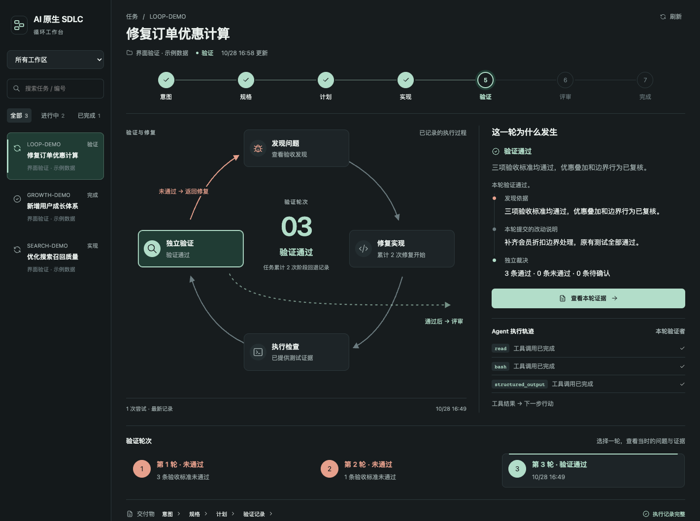

# AI 原生 SDLC × DeepSeek Harness

**让 AI 的「完成了」，有据可查。**

一个 DeepSeek Harness（DSH）插件：按验收标准独立检查代码，跟踪问题的修复与复验，把进度和证据留在项目里。

[](https://github.com/HMYDK/ai-native-sdlc-dsh/actions/workflows/ci.yml)
[](https://www.npmjs.com/package/@ai-native-sdlc-plugin/dsh-sdlc)
[](https://dshfind.com/en/plugins/HMYDK/ai-native-sdlc-dsh?ref=badge)
[](LICENSE)

## 你能得到什么

- **完成有依据。** 新的验证会话读取需求、检查代码、复跑测试，逐项给出验收结果。漏验、无法判断，或代码改了却沿用旧结论，都不能作为通过依据。
- **修复有复验。** 每个问题都有编号、修改说明和测试证据；提交修改后，由独立验证确认是否解决。看板能查到每一轮发现了什么、改了什么、还有什么没解决。
- **换会话能接着做。** 需求、计划、任务状态和验证记录保存在项目文件中，可随代码提交到 Git。后续会话可以读取这些记录继续工作，任务结束后也能据此复盘。

适合有明确验收要求、需要多轮修复或跨会话继续的开发任务。



*看板本地组件预览，使用示例数据。可查看各轮问题、交付物和验证证据。*

## 开始使用

需要 **DeepSeek Harness App** 和已配置的可用模型。安装流程已在 macOS 验证，其他平台尚未完整验收。

在 App 的 **Plugin Manager** 中搜索并安装 `@ai-native-sdlc-plugin/dsh-sdlc`。已配置 `dsh` 命令时，也可以运行：

```sh
dsh plugin --profile desktop add @ai-native-sdlc-plugin/dsh-sdlc@0.6.0
```

App 自带 CLI、Release 安装包、源码构建与排查步骤见[安装指南](docs/installation.md)。

1. 安装后重新打开 DSH，进入要开发的项目目录。
2. **新建会话，选择「AI 原生 SDLC」模式。** 工作流按会话启用，已有会话保留原来的工具组合；侧栏只读看板常驻。
3. 描述任务和验收要求，例如：

```text
创建任务 CART-1：修复会员订单优惠计算错误。
先确认预期行为和验收标准，用失败测试复现问题，再制定计划并修复。
修复后逐项独立验证；发现问题时记录原因、修改证据和复验结果。
```

Agent 通过插件工具推进任务，你在看板查看进度、问题与证据。任务记录位于 `.ai/tasks/<TASK-ID>/`。

原始执行记录位于 `.ai/rsi/`，含代码和工具输出；请在业务项目的 `.gitignore` 中忽略该目录，只提交检查过的任务材料。

## 进一步了解

| 想了解什么 | 文档 |
|---|---|
| 安装、升级和排查 | [安装指南](docs/installation.md) |
| 验收标准、阶段流转、问题处理与复验 | [任务流程](packages/sdlc/TASK.md) |
| 用执行证据复盘、比较改进前后的效果 | [复盘与改进](packages/sdlc/RSI.md) |
| 组件划分、测试冻结与实现细节 | [插件说明](packages/sdlc/README.md) · [工程约定](AGENTS.md) |
| 构建、测试与参与开发 | [贡献指南](CONTRIBUTING.md) |

独立验证仍由模型执行，判断可能出错。插件负责记录和检查开发过程，合并与发布授权由 Git、CI 和权限系统负责。

## 来源与许可

方法参考 Anthropic《AI 原生 SDLC 实战手册》（[原文](https://claude.com/resources/articles/the-ai-native-sdlc-playbook) · [中文导读](docs/playbook-notes.md)）。本项目为社区实现，与 Anthropic、DeepSeek 均无隶属关系。

[MIT](LICENSE) · [第三方声明](packages/sdlc/THIRD_PARTY_NOTICES.md) · [安全问题](SECURITY.md)

## English

A **DeepSeek Harness plugin** that makes AI development work verifiable: independent checks against acceptance criteria, issue-by-issue fixes and re-verification, and project-local records you can resume across sessions. Install one package, select the **「AI 原生 SDLC」** mode in a new session, and follow progress in the dashboard.
