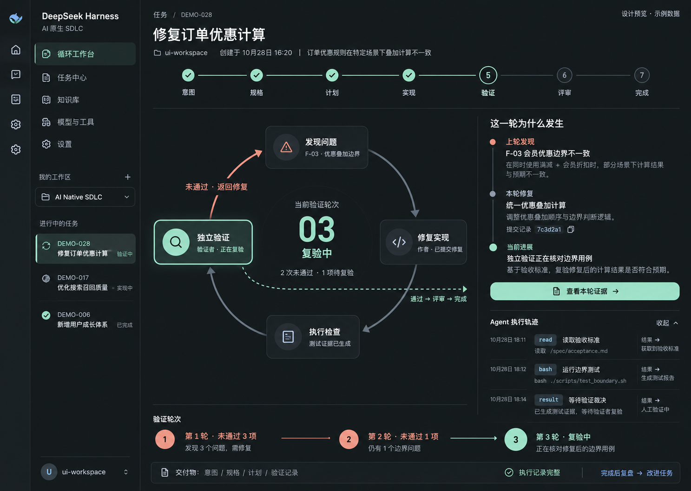
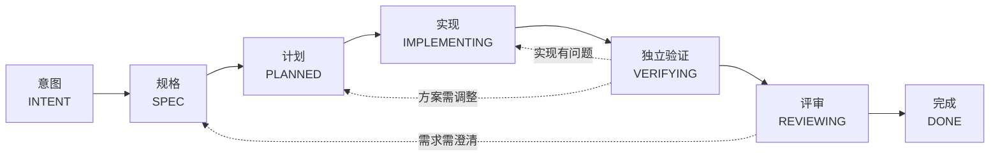

# AI 原生 SDLC × DeepSeek Harness

一个 **DeepSeek Harness（DSH）插件**，把需求、计划、实现、独立验证和评审串成可追踪的开发流程。
任务走到了哪一步、为什么退回、改了什么、复验是否通过，都有文件记录可以核对。

[](https://github.com/HMYDK/ai-native-sdlc-dsh/actions/workflows/ci.yml)
[](https://www.npmjs.com/package/@ai-native-sdlc-plugin/dsh-sdlc)
[](https://dshfind.com/en/plugins/HMYDK/ai-native-sdlc-dsh?ref=badge)
[](LICENSE)

方法来自 Anthropic《AI 原生 SDLC 实战手册》（[原文](https://claude.com/resources/articles/the-ai-native-sdlc-playbook)，作者 Louis Claxton）。
本仓库不收录全文翻译，只提供一篇原创[中文导读](docs/playbook-notes.md)。

当前插件为 [`@ai-native-sdlc-plugin/dsh-sdlc@0.6.0`](https://www.npmjs.com/package/@ai-native-sdlc-plugin/dsh-sdlc)，以一个 npm bundle 交付。
本项目是社区实现，与 Anthropic、DeepSeek 均无隶属关系。



**安装后，新建会话并选择「AI 原生 SDLC」模式才会启用工作流。** 标准会话不加载 SDLC 工具；侧栏只读看板常驻。

## 它能做什么

| 开发中常见的问题 | 插件提供的能力 |
|---|---|
| 换个会话就不知道任务做到哪了 | 任务状态、阶段交付物和流转原因保存在工作区，供后续会话继续读取 |
| Agent 说“完成了”，却没有可核对的结果 | 按验收标准逐项独立验证，返回通过、拒绝或需要人工判断的结构化裁决 |
| 评审发现问题后，只剩一句“已修改” | 给问题固定编号，记录退回阶段、修改证据和独立复验结果 |
| 代码又改了，却继续引用上次的通过结论 | 裁决绑定当时的代码、需求、计划和验收标准；推进阶段时重新检查 |
| 修 bug 时顺手改松了测试 | 复现后冻结测试资产，拦截已覆盖的文件写入和 shell 改写方式 |
| 经常返工，却不知道该改进哪里 | 保存任务执行证据，支持复盘、提出改进、比较新旧版本和跟踪后续效果 |

侧栏看板把这些记录放到一起：七个阶段及其交付物、每次推进与退回、逐项问题处理、历轮验证和记录缺口。
它按实际记录展示路线，例如需求问题退回 `SPEC`、方案问题退回 `PLANNED`。

## 安装与开始使用

以下步骤在 **macOS + DeepSeek Harness App** 上验证过；其他平台的完整安装流程尚未验收。
执行独立验证还需要 DSH 已配置可用的模型。

### 方式一：从 npm 安装（推荐）

```sh
ELECTRON_RUN_AS_NODE=1 "$DSH_BIN" --expose-internals "$DSH_CLI" \
  plugin --profile desktop add @ai-native-sdlc-plugin/dsh-sdlc@0.6.0
```

`$DSH_BIN` 与 `$DSH_CLI` 的定义见下方「安装到 DSH」；也可以在 App 的 Plugin Manager 里直接搜索安装。

### 方式二：使用 GitHub Release 的安装包

1. 打开 [Releases](https://github.com/HMYDK/ai-native-sdlc-dsh/releases)，下载最新的 `.tgz` 与 `SHA256SUMS.txt` 校验文件。
2. 校验后按下面的 **「安装到 DSH」** 步骤安装。

```sh
shasum -a 256 -c SHA256SUMS.txt
```

### 方式三：从源码构建

```sh
git clone https://github.com/HMYDK/ai-native-sdlc-dsh.git
cd ai-native-sdlc-dsh
npm install

export DSH_APP="/Applications/DeepSeek Harness.app"
npm run compat          # 包声明是否接受本机 DSH 版本
npm run preset-sync     # 内置基础工具列表是否仍与 App 一致
npm run build --workspace packages/sdlc

SDLC_PACK="$(npm pack --workspace packages/sdlc --silent)"
SDLC_HASH="$(shasum -a 256 "$SDLC_PACK" | cut -c1-12)"
SDLC_TGZ="$PWD/${SDLC_PACK%.tgz}-$SDLC_HASH.tgz"
mv "$SDLC_PACK" "$SDLC_TGZ"
```

`compat` 与 `preset-sync` 任一失败时，先按输出处理再继续；DSH 升级后也要重新检查。
安装包名加上内容哈希，避免同版本反复打包时安装器复用旧文件。

### 安装到 DSH

使用 **App 自带 CLI**，确保安装命令与实际运行的 DSH 来自同一版本。下面以 `desktop` profile 为例，其他 profile 请替换名称。

```sh
DSH_CONTENTS="$DSH_APP/Contents"
DSH_BIN="$DSH_CONTENTS/MacOS/DeepSeek Harness"
DSH_CLI="$DSH_CONTENTS/Resources/app.asar/dsh/node_modules/@deepseek-ai/dsh-desktop-host/lib/cli.js"

ELECTRON_RUN_AS_NODE=1 "$DSH_BIN" --expose-internals "$DSH_CLI" \
  plugin --profile desktop add "$SDLC_TGZ"
```

包自带 `dsh.bundle.patch`，安装时会登记看板和工作模式。装完核对对应 profile 的 `package.json`：
`dsh.profile.bundles` 中应包含 `@ai-native-sdlc-plugin/dsh-sdlc`。
默认位置是 `~/.dsh/profiles/desktop/package.json`；设置过 `DSH_HOME` 时以该目录为准。
若未登记，按[安装排查说明](docs/dsh-pitfalls.md)处理。

升级已有安装后，**完全退出并重新打开 DSH，再新建会话**，以确认使用新模块。
安装成功本身不能证明旧进程已经加载新版。

### 在业务项目里开始任务

1. 在 DSH 打开要开发的项目目录。
2. 新建会话，选择 **「AI 原生 SDLC」** 模式。
3. 描述目标和验收要求，让 Agent 创建任务并按流程推进。例如：

```text
创建任务 CART-1：修复会员订单优惠计算错误。
先检查现有实现，明确预期行为和验收标准，再制定计划。
用失败测试复现问题，修改后做独立验证；发现问题时记录退回、修改证据和复验结果。
```

这些步骤由会话中的 `sdlc_*` 工具完成。侧栏 SDLC 看板用于查看进度和证据。
已有会话保留创建时的工具组合；安装插件或修改默认模式不会把旧标准会话切换成 SDLC 会话。

## 一个任务怎样完成

正常推进经过七个阶段；发现问题时，回到需要修改的阶段，再重新提交验证。



推进通过 `sdlc_task_advance` 完成，每次都要写明原因并检查目标阶段的条件：

- 进入规格、计划和实现阶段，要有对应的 `intent`、`spec`、`plan` 文件并登记到任务中。制品工具检查结构，内容质量由后续验证判断。
- 重新进入验证前，上一轮问题要提交处理证据，或对允许延期的建议说明原因。
- 进入评审需要最新、完整且仍适用于当前内容的 `approve`，并且没有未解决的阻断问题。
- 完成任务还需要评审交付物；所有问题必须已独立复验解决，或明确延期。`DONE` 不代表已合并或已上线。

### 发现问题以后

验证发现会自动登记为任务问题；评审发现通过 `sdlc_task_issue action=report` 登记。
之后按问题编号处理：

1. **开始处理**：`action=start` 记录原因和目标阶段。改需求退回 `SPEC`，改方案退回 `PLANNED`，改代码退回 `IMPLEMENTING`；仅补证据可以留在当前阶段。
2. **提交修改**：`action=submit` 填写实际改动和测试证据。此时状态是“等待复验”。
3. **独立复验**：重新进入 `VERIFYING`，调用 `sdlc_verify`。验证者逐项返回结果，明确确认解决后才关闭问题；作者不能自行关闭。
4. **明确延期**：非阻断建议可以 `action=defer`，但必须说明原因。阻断问题不能延期。

看板展示每次退回的来源、目标、后续路线和复验结果。重新回到原阶段只表示重新提交，不表示已经通过。
完成后报告新问题会重新进入评审。中断的验证要先用 `cancel_verification` 记录取消，再重试。
完整工具和数据约定见[任务与返工流程](packages/sdlc/TASK.md)。

## 记录保存在哪里

任务记录默认位于**业务工作区**，可以随代码提交到 Git：

```text
.ai/tasks/<TASK-ID>/
  state.yaml                 # 当前阶段、交付物索引、流转历史、问题和验证轮次
  intent.md                  # 为什么做、要解决什么问题
  spec.md                    # 预期行为与验收标准
  plan.md                    # 实现计划
  verifications/<run-id>.json # 每轮裁决、逐项结果和被验证的内容版本
  verification.json          # 最新裁决的兼容副本
  review.json                # 评审交付物
  rsi.json                   # 执行记录完整性与复盘状态摘要
```

文件随流程逐步产生；也可以登记 `proof.md`、`evidence/` 下的文件等自定义交付物。
`state.yaml` 是任务状态和文件索引的依据，`artifacts.verification` 指向具体轮次的裁决。
历史轮次使用对应证据，缺失时明确显示缺口，不拿最新文件替代旧证据。

原始代码快照、模型配置和工具输出保存在 `.ai/rsi/`，本仓库默认将其忽略。
在业务仓库使用时也应配置忽略该目录；这些记录没有通用脱敏，只提交检查过的任务材料和摘要。

## 验证与复盘

**独立验证。** `sdlc_verify` 启动新的验证会话，不继承实现者的会话上下文。
验证者读取交付物、检查代码、复跑测试，并按稳定编号逐项回答验收标准和待复验问题。
结果为 `approve`、`reject` 或 `needs_human`。未拿到完整结构化裁决、漏项、重复或未知编号，以及与当前内容不一致的旧裁决，都不能作为通过依据。

验证者使用单独的工具组合，关闭 `write`、`edit` 和任务推进等工具，但保留运行测试所需的 shell。
**这不等于操作系统层面的只读隔离**：shell 仍有写文件的能力，独立会话也不保证模型判断一定正确。

**测试冻结。** 修 bug 时先写失败测试并确认复现，再调用 `sdlc_fix_start`，修复和复测后调用 `sdlc_fix_end`。
冻结按仓库生效，用于防止修复过程中改松测试。识别依赖文件名和命令模式，且作者可以主动解冻，因此它不是防篡改机制，也不能代替逐项问题处理。

**任务复盘（RSI）。** 正常使用任务和验证工具时，插件记录已登记会话的执行过程、阶段变化与实际插件版本，并报告缺失或截断。
任务完成后，让 Agent 调用 `sdlc_rsi_analyze` 阅读证据，再按需要提出改进、创建普通开发任务、比较新旧版本并记录采用决定和后续效果。
复盘提醒不会在后台自动改代码或安装新版。工具用法见 [RSI 文档](packages/sdlc/RSI.md)。

> 插件负责让开发过程可检查。发布授权、分支保护和密钥管理由 Git、CI 和权限系统负责。
> 工作区记录可被人工修改，客户端检查也可被绕过；本项目不承担合规或发布管控。

## 开发与验证

源码集中在 `packages/sdlc`。**一个包统一安装和升级，七个组件分别运行**：
`task`、`artifact`、`status`、`verify`、`workflow`、`rsi` 和 `ui`。
六个工作流组件挂在「AI 原生 SDLC」模式中；只读 UI 留在宿主层。
各组件保留独立加载行，便于定位故障。详细说明见[包结构](packages/sdlc/README.md)。

```sh
export DSH_APP="/Applications/DeepSeek Harness.app"

npm run verify --workspace packages/sdlc  # 构建 + 单测 + 宿主接口检查 + 运行时冒烟
npm run compat                          # 包声明与本机 DSH 版本
npm run preset-sync                     # 基础工具列表与 App 是否一致
node tools/bench/run.mjs                 # 同一用例比较旧版与修复版
```

冒烟测试使用真实 Cordis 和 ToolRuntime 调用插件工具；涉及模型的集成用例使用预设返回结果。
修改安装、加载或界面接线后，还要把实际 tarball 安装到**隔离 profile**，核对发布文件和运行状态。
`plugin-activation-check.mjs` 可检查安装文件是否与构建一致；进程是否已加载，要继续查看运行时的 `fiberPhase` 和实际行为。
检查工具及用法见 [tools/](tools/README.md)。

DSH 的工作模式不支持继承，因此插件保留了一份 `standard` 基础工具列表。
App 升级后若 `preset-sync` 发现差异，用 `npm run preset-sync:write` 同步，检查改动后重新跑完整验证。
修改插件前请先读 [AGENTS.md](AGENTS.md) 和 [DSH 插件契约](docs/dsh-plugin-contracts.md)。
贡献方式见 [CONTRIBUTING.md](CONTRIBUTING.md)，安全问题见 [SECURITY.md](SECURITY.md)。

### 已保存的验证证据

以下为 **2026-11-01、插件 0.5.0** 的已保存结果，来源是 [ARTIFACT-READ-1 验证记录](.ai/tasks/ARTIFACT-READ-1/proof.md)：

| 检查范围 | 结果 |
|---|---|
| 库与客户端单测 | 242 + 35，共 277 项通过 |
| 看板宿主接口 | 51 项通过 |
| 运行时冒烟 | 10 组，共 459 条通过 |
| 回归 A/B 对照 | 旧版宿主 41 通过 / 10 失败 → 新版 51 / 0；旧版客户端 30 / 5 → 新版 35 / 0 |
| 本地浏览器交互 | 1421×1000 深色、390×844 浅色共 39 项通过，使用明确标注的本地测试数据 |
| DSH 兼容与模式列表 | `0.2.1-rc.5` 兼容检查通过；22 条基础组件 + 6 条 SDLC 组件一致 |

这些结果证明相应程序行为，**不代表真实模型判断质量或最终 DSH 页面已验收**。
本轮是自动回归和作者复查，没有独立模型裁决，任务保留 `VERIFYING`；日常 DSH 进程是否加载新版也未确认。
更早的 FLOW-1 双侧基准（5 个用例）仍成立，读数见 [FLOW-1 验证记录](.ai/tasks/FLOW-1/proof.md)。
RSI 的指导文字对照实验仍与参考答案共享文件系统，仅供探索，不能据此推荐采用候选。
最新提交的构建与单测由 [CI](https://github.com/HMYDK/ai-native-sdlc-dsh/actions/workflows/ci.yml) 持续检查。

## 目录与文档

| 入口 | 内容 |
|---|---|
| [packages/sdlc/](packages/sdlc/README.md) | 插件包、组件划分、工作模式与安装细节 |
| [任务与返工流程](packages/sdlc/TASK.md) | 状态、问题处理、验证版本和工具用法 |
| [RSI](packages/sdlc/RSI.md) | 执行证据、复盘、改进提案与版本对照 |
| [中文导读](docs/playbook-notes.md) | Anthropic 方法论要点与本插件的对应关系 |
| [看板实现记录](docs/design/sdlc-dashboard-2026-10-28/implementation.md) | 阶段流转、交付物、交互检查及验收范围 |
| [tools/](tools/README.md) | 兼容、安装核对、基准、变异与时间偏移检查 |
| [.ai/tasks/](.ai/tasks/) | 本项目的真实任务交付物与验证证据（已脱敏） |
| [docs/](docs/) | DSH 接口调研、插件契约和实测问题记录 |
| [AGENTS.md](AGENTS.md) | 项目决策、工程约定与历史教训 |

## 许可证与第三方

本项目以 [MIT 许可证](LICENSE) 发布。
看板使用 [Tabler Icons](https://github.com/tabler/tabler-icons)（MIT），完整声明见 [packages/sdlc/THIRD_PARTY_NOTICES.md](packages/sdlc/THIRD_PARTY_NOTICES.md)。
Anthropic 方法论原文的版权归 Anthropic 所有，本仓库只提供原创导读与链接，不包含原文译文或插图。

## English summary

A community **DeepSeek Harness (DSH) plugin** that turns an AI-native SDLC into a verifiable workflow:
task state and artifact chain, independent verification with structured verdicts, per-issue rework
and re-verification, test freezing, and RSI-based retrospectives. It ships as one DSH bundle
(`@ai-native-sdlc-plugin/dsh-sdlc`) with a read-only dashboard plus an optional "AI 原生 SDLC" Agent Preset.
Licensed MIT. The workflow is verified on macOS with the DeepSeek Harness App; other platforms are untested.
Not affiliated with Anthropic or DeepSeek.
